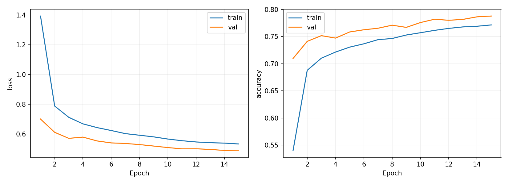
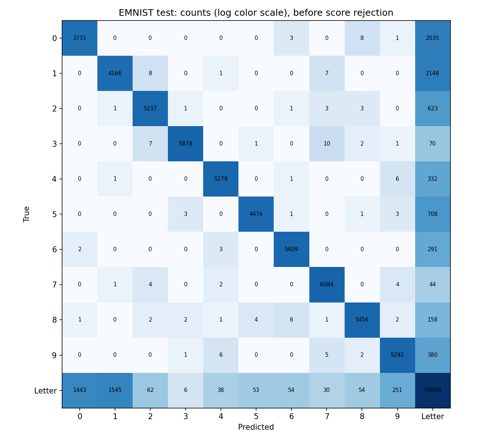
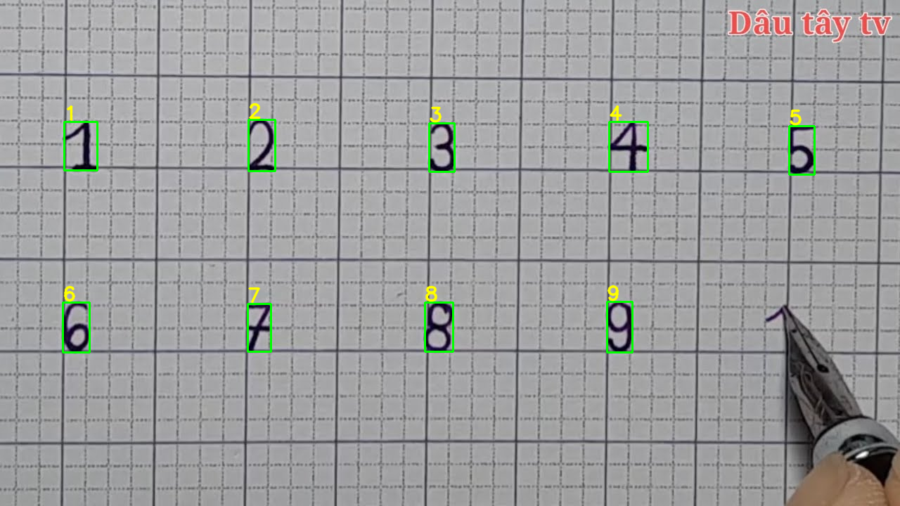
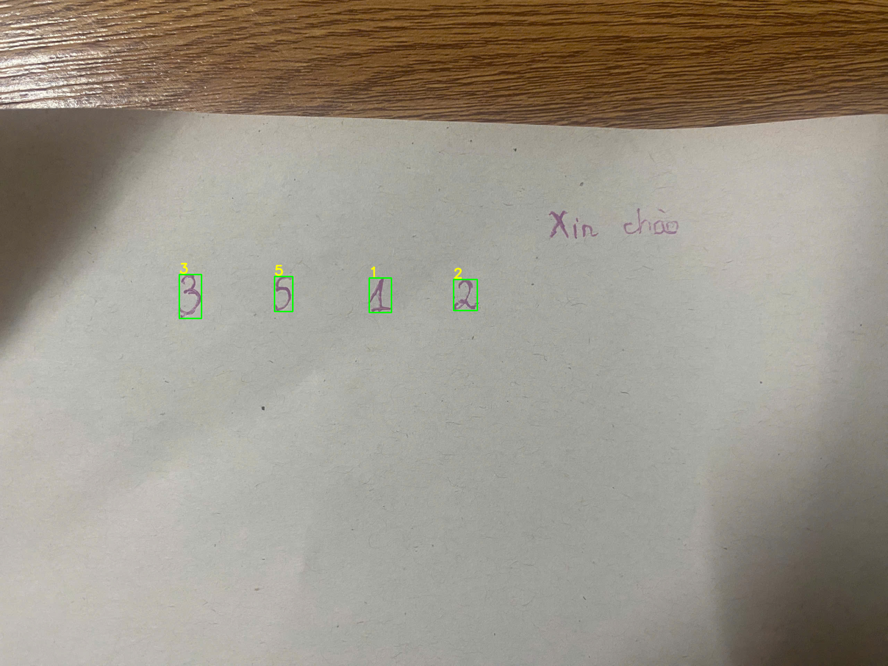
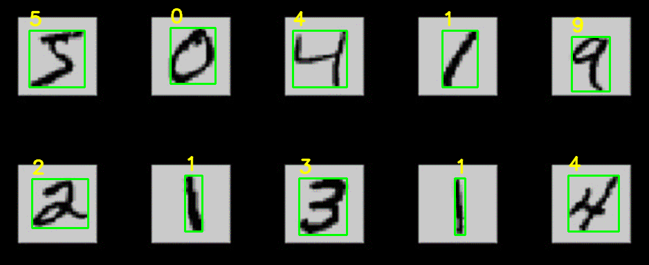

# Báo cáo cuối kỳ — Nhận dạng chữ số viết tay trên giấy

Môn: Xử lý ảnh & Nhận dạng. Cập nhật:2026-11-01. Sinh viên/lớp/giảng viên: bổ sung theo mẫu môn học.

## 1. Mục tiêu và sản phẩm

Nhận ảnh giấy có chữ số viết tay, xuất nhãn0–9, box xanh và nhãn vàng phía trên. Giao diện mở ảnh, xoay trái/phải, chọn ROI, so sánh phương pháp, xem vùng nét và xuất PNG/JSON. Giữ số0 đầu chuỗi và thứ tự theo dòng.

Bản chạy mặc định là **Dãy số rời**: dựa trên nhóm ít nhất3 ký tự cùng cỡ, cách nhau rộng để xác định hàng số. Đây là giả định bố cục, chưa phải bộ OCR tổng quát. Chữ viết cách xa giống hàng số vẫn có thể bị nhận nhầm. Các lựa chọn EMNIST, YOLO EMNIST, YOLO baseline và CNN được giữ để so sánh.

## 2. Dữ liệu và cách chia

- MNIST: baseline CNN,54.000 train/6.000 validation/10.000 test; seed42.
- EMNIST ByClass chính thức:697.932 ảnh train và116.323 ảnh test,62 lớp0–9,A–Z,a–z. Raw được transpose để sửa hướng. Tải bằng torchvision, kiểm tra MD5 archive của NIST.
- Classifier mới lấy tối đa2.500 mẫu/class cho train và200/class cho validation từ train chính thức, seed42; thực tế **152,692 train/12,400 validation**. Lưu chỉ số split và cấu hình theo run. Chưa xác minh split độc lập theo người viết.
- YOLO EMNIST:1.600 train/200 validation/100 test ảnh ghép ký tự viết tay thật lên nền gradient, có nét nhạt/ô ly. Đây vẫn là toàn cảnh tổng hợp. Nguồn ký tự train/validation tách riêng; test từ EMNIST test.
- Hai ảnh người dùng: ảnh ô ly12345/6789 và ảnh điện thoại3512 + Xin chào. Đã dùng phát triển/điều chỉnh tiền xử lý và quy tắc hàng số, nên **không phải test độc lập**. Không huấn luyện checkpoint bằng hai ảnh này.

## 3. Phương pháp

### CNN MNIST baseline

Conv32 → pooling → Conv64 → pooling → Dense128 → Dropout0.3 → softmax10. Mô hình này có thể gán chữ cái thành số vì không có lớp chữ.

### CNN EMNIST62 lớp

Ba khối tích chập32/64/128 kênh, BatchNorm, pooling, adaptive pooling, Dense256, Dropout0.3, đầu ra62 lớp. Chuẩn hóa: crop vùng nét, resize giữ tỉ lệ cạnh dài20, padding28. Train15 epochs bằng AdamW, cosine LR, augmentation xoay±12°, dịch8%, scale0.85–1.15 và shear6°. Không lật ký tự.

Checkpoint chọn theo validation loss. Suy luận chỉ xuất lớp0–9 khi điểm≥0.65; chữ và điểm thấp được ghi trong trường rejected của JSON. Confidence chưa hiệu chuẩn thành xác suất đúng.

### Phân vùng ảnh giấy và dãy số

Đọc EXIF, xoay theo lựa chọn người dùng, giới hạn cạnh dài1800px. Ưu tiên mực xanh/tím bằng HSV với ngưỡng saturation thích ứng; nếu không có đủ màu dùng grayscale, ước lượng nền morphological closing và threshold. Connected components tạo vùng nét, bỏ nhiễu nhỏ, thành phần chạm biên và vùng quá rộng.

Chế độ EMNIST thuần phân loại từng vùng thành62 lớp. Chế độ Dãy số rời bổ sung giả định hàng:≥3 vùng tương tự chiều cao, khoảng cách tâm trung vị>1.8 lần chiều cao trung vị. Với các hàng đó dùng CNN chữ số baseline để giải quyết các dạng giống1/l,8/B; các vùng ngoài hàng bị loại. Nếu không có hàng thỏa điều kiện, trở về quyết định của EMNIST. Đây là quy tắc theo bố cục, không suy ra nhãn từ tọa độ cố định hay chuỗi kỳ vọng.

### YOLO EMNIST

YOLO11n khởi tạo từ baseline chữ số, thay head62 lớp, train12 epochs với ảnh ghép EMNIST. Chỉ lớp0–9 được xuất, các lớp chữ bị bỏ. Checkpoint này chưa được chọn làm mặc định vì kết quả hai ảnh thực còn kém.

## 4. Kết quả thực đo

### Classifier EMNIST trên test chính thức

| Chỉ số | Kết quả |
|---|---:|
| Accuracy62 lớp | 81.24% |
| Tìm đúng số và vượt ngưỡng0.65 | 71.31% |
| Chữ bị chấp nhận nhầm thành số | 471/58405 (0.81%) |
| Số mẫu test | 116,323 |

Các chỉ số trên đo ký tự đã tách sẵn, không gồm lỗi phân vùng ảnh giấy. EMNIST có các dạng chữ/số và chữ hoa/thường giống hình học; việc phân biệt62 lớp có giới hạn. Không được so sánh accuracy62 lớp này trực tiếp với accuracy99,16% của CNN10 lớp trên MNIST.

Ma trận hiển thị số mẫu trước khi loại điểm thấp, gộp52 lớp chữ vào Letter; màu dùng log để nhìn rõ lỗi ít mẫu. Ma trận62 lớp và report theo lớp nằm trong metrics.json.

### YOLO EMNIST trên test ảnh ghép

mAP50 **73.93%**, mAP50–95 **72.70%** trên62 lớp, imgsz416. Đây là chỉ số detection toàn bộ ký tự trên ảnh ghép, không phải accuracy số trên ảnh chụp thật. Các box sai trên ảnh thực khiến mô hình này chỉ được giữ làm lựa chọn thử nghiệm.

### Hồi quy hai ảnh người dùng

Chuỗi trong bảng ghép các dòng để so sánh. Đây là đo trên ảnh phát triển đã biết; xoay ảnh điện thoại90° ngược chiều kim đồng hồ được chỉ định thủ công.

| Phương pháp | Ảnh ô ly (đúng123456789) | Ảnh điện thoại (đúng3512) |
|---|---|---|
| yolo | 2224598928 | 2332 |
| emnist | 23457 | 23512 |
| yolo-emnist | 23488 | Không tìm thấy |
| numeric-rows | 123456789 | 3512 |

Dãy số rời cho đúng9 box/4 box và chuỗi trên hai ảnh; đã xem ảnh annotate để xác minh chữ Xin chào, watermark và bàn không bị khoanh. Chưa có bộ ảnh độc lập đủ lớn để kết luận độ chính xác tổng quát.

Lưu ý độ nhạy: một ảnh JPEG dẫn xuất đã xoay/nén lại từng chỉ nhận351; ảnh gốc qua xoay trong RAM nhận3512. Vì vậy pipeline còn nhạy với resize/nén/mực nhạt, không chỉ nhạy với góc xoay. Minh chứng cuối dùng đúng ảnh gốc. Không ẩn trường hợp thất bại này.

## 5. Kiểm thử và tái lập

26 kiểm thử toàn bộ đạt sau khi thêm EMNIST và GUI; thêm1 kiểm thử GUI về kết quả không có số và xoay trái cũng đạt. Kiểm tra pip check không có xung đột. CLI --help xác nhận các backend và tùy chọn rotation. Đã mở GUI thật trên desktop với ảnh gốc điện thoại, xoay270° theo chiều kim đồng hồ, quan sát kết quả3512/4 box và chữ Xin chào không có box.

Mã train, dữ liệu ghép, seed, split indices, history, confusion matrix, curves, config và checkpoint được lưu. README có lệnh cài/chạy/train/đóng gói. Dataset thô và venv không nằm trong gói ZIP; cần tải lại nếu muốn train. Kiểm thử chưa bao phủ mọi loại ảnh chụp hoặc mọi người viết.

## 6. Hạn chế và hướng phát triển

- Chế độ mặc định dựa vào bố cục dãy số tách rời; chữ cách xa nhau cùng cỡ có thể bị coi là số. Không khẳng định đã giải quyết loại chữ tổng quát.
- Nét đứt, chữ/số dính, mực rất nhạt, chữ có dấu và nén ảnh có thể gây lỗi. EMNIST chỉ có chữ Latin cơ bản, chưa đại diện đầy đủ tiếng Việt có dấu/nét nối.
- Chưa tự suy ra hướng đọc; cần xoay ảnh để chữ đứng thẳng. Không ép chọn hướng bằng điểm mô hình vì có thể làm nhầm6/9.
- Cần tập ảnh thật có box/nhãn, tách theo người viết và điều kiện chụp, gồm nền bàn, giấy ô ly, bóng và chữ–số cùng màu. Chỉ thay mặc định sau khi đo đủ cả bỏ sót số và nhận chữ/vật thể thành số.
- Chưa có video demo, thông tin sinh viên, mẫu báo cáo chính thức hay xác nhận nộp bài; đây là bản mã/tài liệu/gói sản phẩm để nộp sau khi bổ sung thông tin môn học.

## 7. Kịch bản demo

1. Mở run_demo.cmd, giải thích phạm vi Dãy số rời.
2. Mở ảnh gốc điện thoại, xoay trái90°, nhận dạng3512 và đối chiếu Xin chào không có box.
3. Mở ảnh ô ly, nhận dạng12345/6789, lưu PNG/JSON.
4. Đổi sang EMNIST hoặc YOLO để minh họa lỗi còn lại; không chỉ trình bày trường hợp đúng.
5. Trình bày curves, confusion matrix, cách chia dữ liệu và kế hoạch kiểm tra ảnh độc lập.

## 8. Tham khảo

- [NIST EMNIST](https://www.nist.gov/itl/products-and-services/emnist-dataset)
- [Torchvision EMNIST](https://docs.pytorch.org/vision/stable/generated/torchvision.datasets.EMNIST.html)
- [Ultralytics YOLO11](https://docs.ultralytics.com/models/yolo11/)
- [Keras MNIST](https://keras.io/api/datasets/mnist/)
- [DataFlair theo đề bài](https://data-flair.training/blogs/python-deep-learning-project-handwritten-digit-recognition/) — truy cập trực tiếp bị403 ở phiên chuẩn bị, không dùng để khẳng định chi tiết triển khai.

### Giao diện sử dụng hằng ngày

Luồng chính đã gọn thành Mở ảnh → xoay nếu cần → Nhận dạng; không yêu cầu chọn phương pháp cho từng ảnh. Các phương pháp so sánh/bộ lọc được đưa vào Nâng cao và mặc định ẩn. Đóng Nâng cao đặt lại cấu hình mặc định. Thay đổi này không bổ sung cơ chế tự chọn mô hình tối ưu theo ảnh; các giới hạn nhận dạng đã nêu vẫn áp dụng. Năm kiểm thử GUI/ảnh liên quan được chạy lại và đạt.

### Hồi quy bổ sung: image-15.png

Ảnh ghép hai hàng ô sáng trên nền đen, nhãn thủ công50419/21314. Trước sửa xuất54; nguyên nhân quan sát là viền pixel màu làm bật lọc màu, lấy cả khung ô thay cho nét. Bổ sung phát hiện>=3 ô sáng chữ nhật tương tự kích thước, bỏ4% viền và threshold riêng bên trong mỗi ô. Sau sửa nhận đúng10 nhãn và box. Đây là cải tiến phân vùng tự động, không đổi checkpoint hoặc hardcode nhãn. Sáu kiểm thử liên quan đạt; hai ảnh giấy cũ vẫn đọc đúng chuỗi. Ảnh này được thêm vào bộ hồi quy phát triển, không phải test độc lập.

### Sửa bỏ sót mực đỏ trên OIP (1).webp — 2026-11-01

Đã tái hiện cấu hình mặc định trả0 box. Ảnh474×266 có bảng0–9, chữ đỏ và số1 trong tiêu đề. Mục tiêu hồi quy của ca này là10 số trong bảng; chưa yêu cầu/kiểm chứng số1 nằm trong tiêu đề. Bộ lọc trước chỉ chọn xanh/tím; nét số nhỏ còn có viền đen và nhiễu nén nên mask màu đơn thuần làm mất nét/lấp ruột ký tự. Bổ sung đề xuất màu đỏ độc lập, chọn dải màu theo diện tích các vùng nét không chạm biên thay vì gộp ngưỡng chung (bản gộp từng làm ảnh điện thoại sai371, đã loại bỏ). Khi chọn đỏ, dùng màu làm seed rồi giữ thành phần nét tối lân cận trên ảnh chuẩn hóa nền; threshold từ phân bố độ tối ở seed. Ảnh nhỏ không dùng closing3px để tránh lấp ruột ký tự. Không hardcode nhãn, không thay checkpoint.

Kết quả cuối:01234/56789,10 box, xem reports/figures/oip_after.png. Bốn ảnh phát triển hồi quy đều đúng chuỗi bảng/dãy kỳ vọng:0123456789,5041921314,123456789,3512. Bảy kiểm thử EMNIST/tiền xử lý đạt, có ca mực đỏ giữ viền đen. Đây là điều chỉnh trên ảnh phát triển đã biết; không phải test độc lập, chưa chứng minh hỗ trợ mọi bố cục hoặc ảnh mực nhiều màu. Tự xử lý trong cấu hình mặc định, không yêu cầu người dùng chọn phương pháp; mở lại ứng dụng để nạp mã mới.

### Ảnh dày OIP.webp — 2026-11-01

Ảnh474×265 có10 hàng0–9,20 ví dụ/hàng, tổng200 số theo đối chiếu bố cục thủ công. Bản trước chỉ xuất130 box, nhiều0/1/8 bị EMNIST loại như chữ, khoảng cách không đạt quy tắc dãy rời. Đã bổ sung nhận biết lưới dày:ít nhất3 hàng, mỗi hàng>=8 vùng, nhịp cột biến thiên tương đối<0.35 và khoảng cách tâm>0.7 chiều cao trung vị. Các nhãn vẫn do CNN dự đoán từng ô, không gán nhãn theo hàng/đa số. Gộp thành phần nét đứt nhỏ khi trang grayscale có>=50 thành phần, chồng lấp ngang/gap dọc đủ gần; giữ nguyên pixel foreground, không thêm nét hoặc gộp hàng kế bên. Nhãn vẽ nhỏ hơn theo chiều cao vùng.

Sau sửa tách đủ200 vùng, đọc đúng199/200 theo nhãn thủ công; lỗi còn lại hàng5 cột14:số4 đọc8, bbox313,111,14,18 và điểm0.9561. Giữ lỗi nguyên vẹn. Metrics reports/dense_evaluation.json; ảnh reports/figures/dense_after.png; crop gốc lỗi reports/figures/dense_error_original.png. 99,5% chỉ là trên ảnh phát triển này, không phải accuracy tổng quát; nguồn ảnh chưa rõ, có thể trùng dữ liệu MNIST. Bốn ảnh phát triển cũ vẫn đúng chuỗi kỳ vọng,8 kiểm thử liên quan đạt. Đã thêm ca dense vào check_real_photos với expected đầy đủ để test tiếp sẽ phản ánh exact_match=False. Lưới chữ cái cùng hình thức vẫn có thể bị nhận thành số; chưa giải quyết loại chữ tổng quát.
