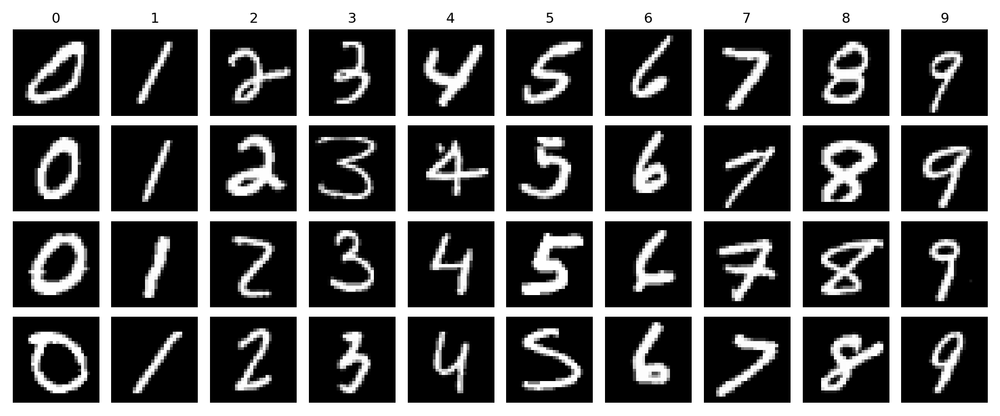
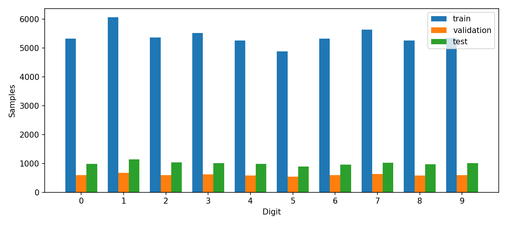
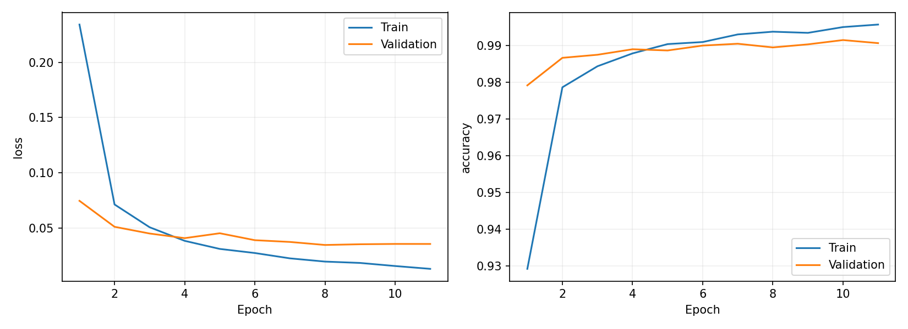
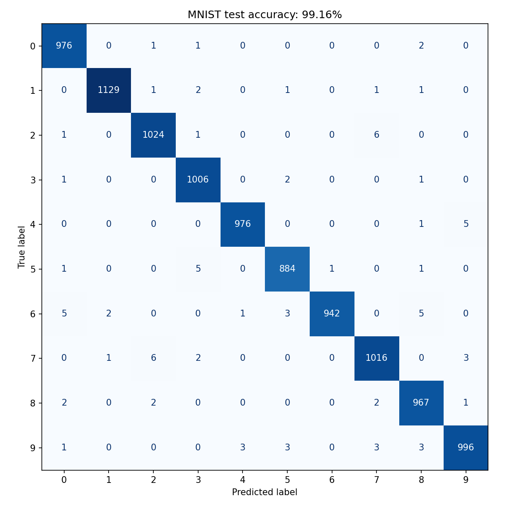
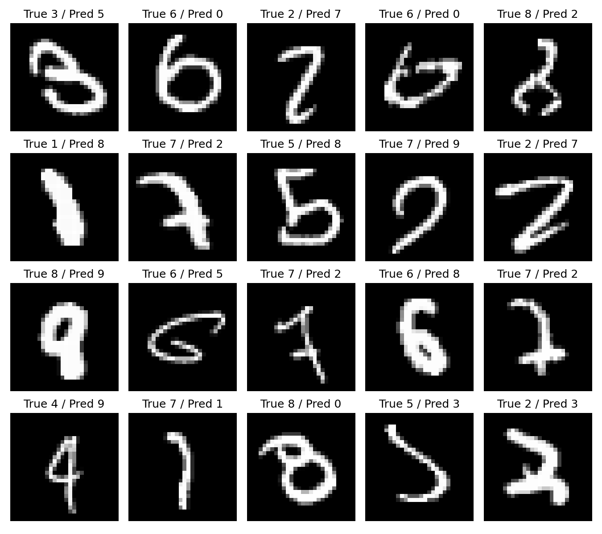
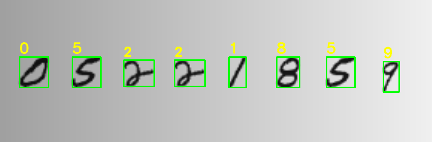
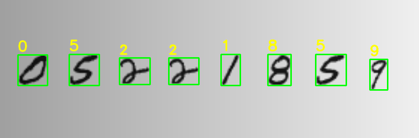
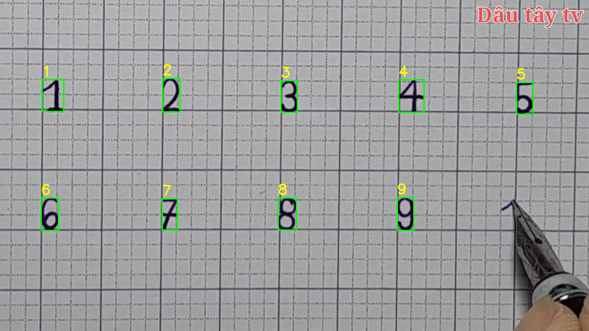

# Báo cáo: Hệ thống nhận dạng chữ số viết tay

**Môn học:** Xử lý ảnh & Nhận dạng  
**Ngày cập nhật:** 2026-10-30  
**Sinh viên / lớp / giảng viên:** bổ sung trước khi nộp.

## 1. Mục tiêu và phạm vi

Xây dựng hệ thống phân loại một chữ số viết tay 0–9 bằng CNN. Đầu vào chính theo yêu cầu đã làm rõ là ảnh chụp chữ số viết trên giấy; người dùng tải ảnh, hệ thống tự phân vùng nhiều chữ số, nhận dạng và ghi nhãn trên ảnh. Canvas/webcam là tiện ích phụ. Đầu ra gồm nhãn, điểm softmax của 10 lớp và ảnh đã tiền xử lý. Hệ thống không nhận dạng chuỗi nhiều số và không phát hiện đầy đủ đầu vào ngoài 10 lớp.

## 2. Dữ liệu

Dùng [MNIST qua Keras](https://keras.io/api/datasets/mnist/): 60.000 ảnh phát triển và 10.000 ảnh test, grayscale 28×28. Tách phân tầng 6.000 ảnh validation với seed 42; 54.000 ảnh còn lại dùng huấn luyện. Tập test không tham gia chọn checkpoint. Ảnh chuyển float32, chia 255, thêm chiều kênh.

Thống kê máy đọc được nằm ở `data_summary.json`. Không có bộ ảnh chữ viết thật có nhãn ở phiên bản này; ảnh `data/samples/synthetic_1.png` được tạo bằng OpenCV để kiểm tra luồng chạy, không phải dữ liệu viết tay độc lập.

## 3. Tiền xử lý ảnh bên ngoài

Cập nhật ảnh giấy: giao diện `demo_photo` và CLI mặc định dùng `mode=paper`. Áp dụng hướng EXIF điện thoại, cho phép xoay ảnh và chọn ROI. Giới hạn cạnh dài 1.200 pixel, morphological closing ước lượng nền rồi chia ảnh cho nền để giảm ánh sáng không đều; kết hợp Otsu với ngưỡng tối thiểu 15. Loại thành phần chạm biên để giảm bóng mép; cần chừa viền giấy quanh nét khi khoanh vùng. Chưa đánh giá trên ảnh giấy thật; giấy kẻ dòng, bóng mạnh, mực nhạt có thể gây lỗi. Các bước crop/resize/căn tâm dùng chung.

Luồng `standard` dùng cho canvas/ảnh tách nền:

Ảnh màu được chuyển grayscale; alpha được ghép trên nền trắng. Chế độ tự động dựa vào trung vị viền ảnh để xác định nền và đổi về nét sáng/nền tối. Otsu tạo mask; connected components loại các vùng nhỏ. Crop theo nét, resize giữ tỉ lệ để cạnh dài bằng 20 pixel, padding 28×28 rồi căn tâm khối lượng. Cuối cùng chuẩn hóa float32 về [0,1].

Threshold dùng tìm vùng nét và loại nền; cường độ grayscale của nét được giữ lại. Hàm chung phục vụ CLI, canvas và webcam. Kiểm tra tương phản và diện tích nét giúp phát hiện ảnh trống cơ bản. Nền phức tạp hoặc bóng mạnh vẫn có thể tạo vùng giả. Giữ tỉ lệ và căn tâm giảm khác biệt hình học với MNIST, nhưng chưa loại bỏ hoàn toàn khác biệt miền dữ liệu.

## 4. Mô hình và cấu hình

| Thành phần | Cấu hình |
| --- | --- |
| Khối 1 | Conv2D 32 filters, 3×3, same, ReLU; MaxPool 2×2 |
| Khối 2 | Conv2D 64 filters, 3×3, same, ReLU; MaxPool 2×2 |
| Phân loại | Flatten; Dense 128 ReLU; Dropout 0.3; Dense 10 softmax |
| Số tham số | 421.642 |
| Optimizer / loss | Adam LR 0.001 / sparse categorical cross-entropy |
| Batch / seed | 128 / 42 |
| Dừng và checkpoint | Tối đa 15 epochs, patience 3; chọn validation loss nhỏ nhất |
| Augmentation | Không sử dụng trong baseline |
| Môi trường | Python 3.11.9, TensorFlow 2.20.0, Keras 3.15.1, Windows, CPU |

Seed và deterministic ops được thiết lập; khác biệt phiên bản/phần cứng vẫn có thể ảnh hưởng tính tái lập. Các phiên bản đầy đủ nằm trong `requirements-lock.txt`.

## 5. Kết quả thực nghiệm

Run **20261030_163159_141552**. Huấn luyện 11 epochs trong khoảng **46,99 giây**; checkpoint tốt nhất theo validation loss ở **epoch 8**. Kiểm tra nạp lại mô hình đạt sai khác trong ngưỡng `1e-6` trên 16 mẫu validation.

| Chỉ số | Giá trị |
| --- | --- |
| Train accuracy ghi trong history tại epoch 8 | 99,3778% |
| Validation accuracy tại epoch 8 | 98,9500% |
| Test accuracy (10.000 mẫu) | **99,1600%** |
| Test loss | **0,026190** |
| Số dự đoán test đúng / sai | 9.916 / 84 |

Train accuracy trên là metric tích lũy trong epoch có dropout, không phải đánh giá lại toàn bộ train bằng checkpoint cuối epoch. Test accuracy cao hơn validation accuracy trong lần chạy này; không nên kết luận từ đó rằng test dễ hơn trong mọi thí nghiệm. Mục tiêu định hướng ≥98% MNIST đã đạt trong lần chạy này, chưa có đánh giá nhiều seed.

Train loss tiếp tục giảm sau epoch 8 nhưng validation loss không cải thiện; đây là dấu hiệu bắt đầu overfitting. EarlyStopping khôi phục checkpoint epoch 8 dù một epoch sau có validation accuracy cao hơn, vì tiêu chí chọn đã được xác định là validation loss.

Hàng biểu thị nhãn thật, cột là nhãn dự đoán. Các lỗi nổi bật gồm 7→2 (6 mẫu), 2→7 (6), 6→0 (5), 6→8 (5), 5→3 (5), 4→9 (5). Đây là thống kê trực tiếp từ confusion matrix. Những nét khép/mở hoặc cách viết khác nhau có thể là nguyên nhân; cần xem từng mẫu trước khi khẳng định nguyên nhân cụ thể.

Metrics theo lớp, xác suất từng ảnh, history và cấu hình nằm trong `experiments/20261030_163159_141552/`. Các ảnh lỗi phục vụ phân tích báo cáo, không dùng chỉnh mô hình theo test.

## 6. Demo và kiểm thử

- CLI: đã chạy `synthetic_1.png`, dự đoán lớp 1; ảnh sau xử lý lưu tại `figures/prediction_input.png`. Đây chỉ là smoke test.
- Canvas: đã kiểm tra tự động việc khởi tạo Tkinter, vẽ nét, gọi mô hình thật, hiển thị 10 điểm lớp, xóa và cảnh báo ảnh trống. Chưa có thử nghiệm người dùng hoặc tập chữ viết thật có nhãn.
- Webcam: luồng chụp ROI, dự đoán, thoát và xử lý thiếu thiết bị đã kiểm tra bằng camera giả lập. Kiểm tra camera index 0 thực tế không mở được thiết bị; chưa xác minh chất lượng nhận dạng webcam thật.
- Sau cập nhật ảnh giấy, 17 kiểm thử tự động đạt, gồm EXIF, giấy trống có gradient, giữ nét trên gradient và giao diện tải ảnh/crop/dự đoán/xoay/reset. Các mẫu là tổng hợp, chưa thay thế đánh giá ảnh giấy thật; `pip check` không phát hiện xung đột phụ thuộc. Notebook là tài liệu khám phá tùy chọn; pipeline CLI đã chạy, notebook chưa chạy bằng kernel Jupyter trong phiên này.

Lần train đã lưu đủ checkpoint/history/summary và kiểm tra reload, sau đó lỗi mã hóa cp1252 ở dòng in kết quả tiếng Việt cuối cùng. Mã đã được sửa để stdout/stderr dùng UTF-8; không huấn luyện lại vì lỗi xảy ra sau khi lưu sản phẩm. TensorFlow còn ghi cảnh báo thuộc tính dataset bị bỏ qua; train và evaluate vẫn hoàn tất tính toán.

## 7. Hạn chế và hướng phát triển

Kết quả MNIST chưa chứng minh chất lượng trên ảnh chụp thật. Cần thu thập bộ chữ số có nhãn từ nhiều người, tách tập phát triển với tập đánh giá, lưu điều kiện chụp và báo cáo accuracy riêng. Tiền xử lý tự động giả định nền khá đồng nhất; nhiều chữ số hoặc họa tiết có thể bị gộp. Softmax chưa được hiệu chuẩn, không phải bảo đảm kết quả đúng. Có thể nghiên cứu augmentation nhẹ, dữ liệu thực tế và cơ chế từ chối ngoài phân bố sau khi có dữ liệu phù hợp.

## 8. Kịch bản trình bày

1. Giới thiệu bài toán một chữ số, mẫu MNIST và cách chia dữ liệu.
2. Minh họa ảnh trước/sau tiền xử lý, giải thích threshold, resize và chuẩn hóa.
3. Trình bày CNN, curves, confusion matrix và các lỗi điển hình.
4. Viết số lên giấy, chụp ảnh, mở trong giao diện chính, bấm nhận dạng toàn ảnh; xem khung xanh, nhãn vàng, chuỗi số và ảnh tiền xử lý.
5. Thử ảnh trống, xoay và chọn vùng khác; giải thích hạn chế ảnh chụp thật. Canvas/webcam là phần phụ.
6. Trình bày cách tái lập theo README và các việc còn lại trước khi nộp.

## 9. Tài liệu tham khảo

1. [DataFlair — Handwritten Digit Recognition using Python](https://data-flair.training/blogs/python-deep-learning-project-handwritten-digit-recognition/). Tài liệu định hướng theo đề bài; truy cập trực tiếp trả 403 trong phiên chuẩn bị, không sử dụng để khẳng định chi tiết mã của bài.
2. [Keras — MNIST dataset](https://keras.io/api/datasets/mnist/).
3. [Keras — Training and evaluation](https://keras.io/guides/training_with_built_in_methods/).
4. [TensorFlow — Install with pip](https://www.tensorflow.org/install/pip).

## 10. Mở rộng theo mẫu: tự phát hiện nhiều chữ số

`src/detect.py` dùng giảm nền, Otsu, connected components để lấy vùng chữ số rời nhau. Lọc thành phần nhỏ/chạm biên và vùng quá ngang; gom dòng bằng độ chồng lấp dọc, sắp trái sang phải. Mỗi vùng giữ mask riêng, chuẩn hóa 28×28 rồi đưa vào CNN hiện có theo batch. Kết quả gồm chuỗi, bbox, điểm 10 lớp, khung xanh và nhãn vàng. GUI lưu PNG/JSON; bbox tham chiếu ảnh xuất (cạnh dài tối đa 1600), ROI xuất riêng nếu có chọn vùng.

Ví dụ này ghép chữ số từ MNIST **train** lên nền gradient, nhận được 8 vùng và chuỗi `05221859`. Đây là minh họa chức năng, không phải ảnh giấy thật hay phép đo accuracy độc lập. Hình người dùng gửi có sẵn khung/nhãn, chỉ dùng định hướng hiển thị. Bốn kiểm thử bổ sung bao phủ chuỗi và lưu file, thứ tự hai dòng, giấy trống gradient và hệ tọa độ ảnh lớn; tổng 17 tests đạt. Giới hạn hiện tại: chữ số phải tách rời, nền khá đơn giản; nét đứt có thể tạo nhiều vùng, nét dính tạo một vùng. Chưa có phép đo chất lượng phân vùng/chuỗi trên bộ ảnh giấy thật.

## 11. Thực nghiệm Ultralytics YOLO11n (2026-10-31)

Fine-tune YOLO11n khởi tạo từ COCO, thay head10 lớp chữ số. GPU RTX A2000 8GB, Ultralytics8.3.221, Torch2.7.1+cu128. 1.200 train/200 validation/100 test ảnh tổng hợp; nguồn nét chữ tách riêng. Train20 epochs, khoảng447,5 giây, checkpoint tốt nhất theo validation. Chi tiết trong `yolo/README.md` và cấu hình run ở `models/yolo/digits_20261031_180956/`.

Test tổng hợp100 ảnh/557 chữ số, imgsz416: precision99,2441%, recall98,5015%, mAP50 99,2604%, mAP50–95 97,8113%. Không dùng các chỉ số này làm accuracy ảnh chụp thật. Mô hình dự đoán trực tiếp box và lớp, không sử dụng connected components để tạo box khi backend YOLO được chọn.

Ảnh demo ngang dài ban đầu ở imgsz416 nhầm một8 thành9. Đổi kích thước suy luận GUI/CLI YOLO sang640 để giữ chi tiết nét nhỏ; demo đọc đúng8 vùng `05221859`. Đây là điều chỉnh trên ảnh minh họa ghép từ MNIST train, không trên test; chưa đo lại test ở640, nên chỉ số test trên vẫn thuộc cấu hình416. 20 kiểm thử đã đạt, sau thay đổi kích thước3 kiểm thử YOLO được chạy lại và đạt. Cần ảnh giấy gốc có nhãn/box để đánh giá tiếp.

Cập nhật2026-11-01: đã huấn luyện và chọn checkpoint `mixed_20261101_130618`, GUI tự dùng mô hình mới khi mở lại. Test tổng hợp100 ảnh có213 số/266 chữ: precision số **95,12%** (cũ41,86%), recall **91,55%** (cũ95,31%); số chữ nhận nhầm thành số **1/266** (cũ221/266). Ngưỡng0.25, imgsz640, đúng box ở IoU≥0.5 và đúng lớp. Số liệu: `reports/yolo/mixed_comparison_test.json`, validation: `reports/yolo/mixed_comparison_val.json`. Mức cải thiện này chưa được xác nhận trên ảnh giấy thật. Chữ O/0 và I/l/1 vẫn có thể gây nhầm; cần dữ liệu theo ngữ cảnh thực tế. Con trỏ mô hình cũ được giữ tại `models/yolo_previous.json`.

### Phản hồi triển khai và rollback (2026-11-01)

Người dùng ghi nhận mô hình mixed nhận số kém hơn bản trước. Đã rollback về digits_20261031_180956; mixed giữ lại để nghiên cứu. Các chỉ số tổng hợp cải thiện precision nhưng giảm recall không chứng minh cải thiện trên ảnh thật. Chưa có ảnh lỗi để kết luận nguyên nhân. Cần kiểm tra hồi quy bằng bộ ảnh thực tế trước khi đổi mặc định tiếp. Demo sau rollback đọc05221859;3 kiểm thử YOLO đạt, chỉ xác nhận luồng chạy và ảnh minh họa.

### Phân tích ảnh thật do người dùng cung cấp

Ảnh maxresdefault (1).jpg có9 chữ số hoàn chỉnh12345/6789; nét gần đầu bút chưa xác định nhãn. YOLO10 lớp xuất sai và báo nhầm watermark/bút; mixed11 lớp chỉ tìm được8. Thử nghiệm tiền xử lý theo màu (HSV H95–170,S≥60,V≤210) loại ô ly xám và watermark đỏ. Kết hợp phân vùng + CNN và lọc mảnh nhỏ theo trung vị chiều cao, nhận đúng9 nhãn trên ảnh này. Đây là điều chỉnh trên ảnh phát triển đơn lẻ, không đo accuracy tổng quát và không giải quyết chữ cùng màu mực. Chưa thay checkpoint mặc định. Hai kiểm thử chức năng bổ sung đạt.

### Test ảnh điện thoại người dùng — 2026-11-01

Ảnh `1793514116442_2209075521745795385_8089266940901408211_d5688339a935afbe7d6fb5b0681671ad.jpg` có4 số3512 và chữ Xin chào cùng mực tím. Đã test3 chế độ trên hướng gốc và xoay90° ngược chiều kim đồng hồ (6 lượt). Hướng gốc: YOLO xuất5/5/5, mixed không tìm thấy, blue-ink xuất4. Hướng đứng: YOLO xuất2/332 (2 nhãn đúng ở3 và2, 5→3, thiếu1; box2 trên vân gỗ); mixed không tìm thấy; blue-ink xuất4/1, cả hai box nằm trên chữ, không trên4 số. Đã xem trực tiếp ảnh annotate để đối chiếu. JSON đầy đủ: reports/user_photo2_test.json; ảnh: reports/figures/user_photo2_upright_yolo.png và user_photo2_upright_blue_ink.png. Không chỉnh threshold, không huấn luyện hoặc thay checkpoint trong phép test này. Xoay đúng chiều chưa giải quyết lỗi; mực nhạt/cùng màu chữ, số nhỏ so với toàn cảnh và nền bàn là các khác biệt cần điều tra. Kết quả trước trên giấy ô ly không tổng quát. Cần giữ ảnh này làm regression case và đánh giá cả bỏ sót số lẫn nhận chữ/vật thể thành số. Các con số3512 là nhãn đối chiếu thủ công, không phải output đã sửa.
